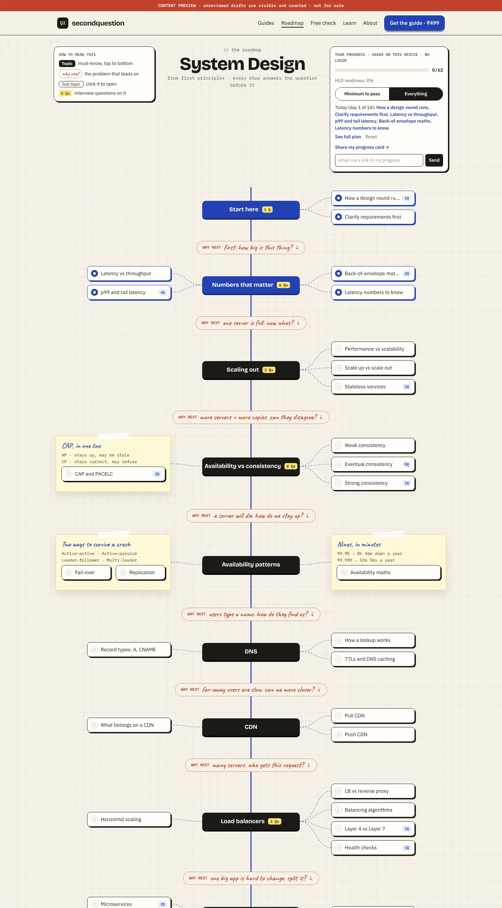
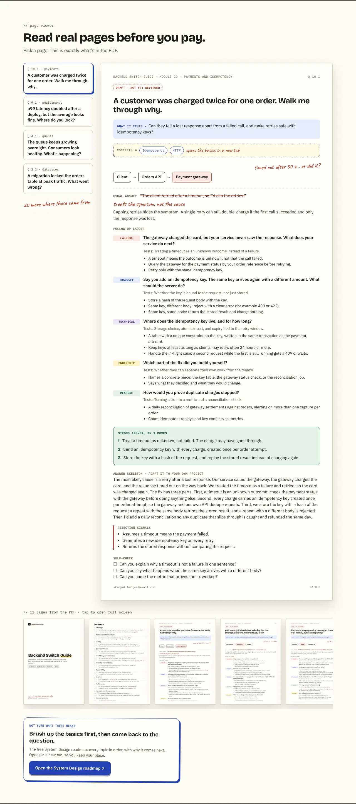

# The System Design roadmap: plan and what's built

**Positioning:** _the system design roadmap that shows what the interviewer asks next._

The roadmap is free. It teaches the basics in order, from first principles, and every topic ends
with the follow-up questions an interviewer actually asks. The paid guides stay the main product:
the roadmap is the "not sure what these mean?" layer that sends people back to them.

Live at `/roadmap/system-design`, with one indexable page per reviewed topic at
`/roadmap/system-design/<topic>`.

## What it looks like

All screenshots are from local dev with draft content visible (the red banner).

**The map.** A central spine of sections, sub-topics branching left and right, dotted connectors,
taped notes for grouped topics. Between every two sections a red **"why next"** pill states the
problem that leads to the next idea ("where does the data actually live?" → Databases → "okay,
can we make it faster?" → Caching). Each topic shows how many interview questions it has.

**A topic.** Clicking a topic opens a drawer (the URL changes, so Back and sharing work). Four
tabs: Explain, They ask, Real world ☁, Self-check. In _They ask_ the interviewer's question sits in
a blue box, the usual answer is crossed out, the follow-ups arrive as interviewer bubbles, and the
strong answer is three first-principles moves. A second question is shown blurred with an
"Unlock in the guide" button.

**Real world ☁.** The same idea on AWS, Google Cloud and Azure, with when to use which, a docs
link, a "gotcha", and the date the mapping was last checked. The rule it teaches: _name the idea,
then the service, then why it fits._

**On a phone.** The map becomes a stacked list with the why-next pills between sections; a topic
opens as a bottom sheet.

| Map on a phone                                                                         | Topic as a bottom sheet                                                                  |
| -------------------------------------------------------------------------------------- | ---------------------------------------------------------------------------------------- |
|  |  |

**Links from the guide.** Every guide question lists the concepts it tests as chips that open the
roadmap topic in a new tab, and the product page, Readiness Check result and `/learn` articles
carry a "Not sure what these mean?" card.

## Market research (condensed)

Figures are from public pages at the time of research; recheck before quoting them anywhere.

| Product                 | What it is                                       | Price (approx.)         |
| ----------------------- | ------------------------------------------------ | ----------------------- |
| roadmap.sh              | Free community roadmaps, huge reach (~3M+ users) | Free; Pro ~$10/month    |
| ByteByteGo              | System design course and newsletter              | ~₹3,500/year            |
| InterviewReady          | System design course, India-focused              | ~₹6,590                 |
| Arpit Bhayani's courses | Cohort-based deep dives                          | ~₹50,000                |
| Hello Interview         | Mock interviews and written guides               | Subscription / per mock |
| NeetCode, takeUforward  | DSA-first, some system design                    | Subscription / free     |

**The gap.** Roadmaps tell you _what_ to learn. Courses explain _how it works_. Almost nobody shows
_what the interviewer asks after your first answer_, and nobody ties a concept to the cloud
service names Indian interviewers expect you to drop. That second question is what this product
is named after.

## What we take from roadmap.sh, and what we don't

- **Taken (ideas, not content):** the layout pattern (spine, branches, grouped boxes), progress
  without login, "click a topic to open it".
- **Not taken:** any text, diagrams, resource lists or visuals. roadmap.sh's content licence
  allows personal use only.
- **Coverage instead follows the System Design Primer** (CC BY 4.0), credited on the map: _"Topic
  coverage follows the open-source System Design Primer (CC BY 4.0). All explanations and
  questions are our own."_

## Free vs paid

| Free (roadmap)                                      | Paid (guides, one-time, no subscription)       |
| --------------------------------------------------- | ---------------------------------------------- |
| All 62 topics: explanation, why-here, diagram       | Every follow-up ladder, in full                |
| One full interview question per topic               | Answer skeletons, rejection signals            |
| Cloud mapping (AWS / GCP / Azure)                   | PDF + phone edition, updates, AI drill (later) |
| Progress, Minimum/Everything path, 7/14/30-day plan |                                                |
| Share card, "email me my progress" link             |                                                |

The second question on each topic is blurred and links to the guide that answers it (or to the
System Design guide waitlist when it isn't out yet).

## Funnel and go-to-market

1. **Search:** one static page per reviewed topic, with FAQ JSON-LD from its free question, in the
   sitemap. Target "<concept> interview questions" searches.
2. **Social:** the 1080×1350 progress card (`/og/roadmap`) for LinkedIn and Instagram: "12 / 40
   topics interview-ready".
3. **Email:** "email me a link to my progress" captures a lead with no marketing consent; the link
   merges progress on another device.
4. **Upsell:** the locked question, the "Questions that test this" list, and the guide's concept
   chips all point both ways.
5. **Measure:** `roadmap_view`, `node_open`, `status_change`, `upsell_click`, `share_card` events.

## How it's built

| Piece                     | Where                                                                     |
| ------------------------- | ------------------------------------------------------------------------- |
| Sections, order, why-next | `content/roadmap/system-design/roadmap.yaml`                              |
| Topics (one file each)    | `content/roadmap/system-design/topics/<id>.md`                            |
| Cloud mapping             | `content/roadmap/cloud-map.json` (`lastVerified` date)                    |
| Schema and loader         | `lib/roadmap/schema.ts`, `lib/roadmap/load.ts`                            |
| Layout engine             | `lib/roadmap/layout.ts` (server-side, pure; tested for overlaps)          |
| Progress and plan         | `lib/roadmap/progress.ts`, `lib/roadmap/plan.ts` (localStorage, no login) |
| UI                        | `components/roadmap/*`, `app/roadmap/system-design/*`                     |

Same rules as the guides: **only `reviewed: true` topics go live.** `pnpm content:validate` checks
every id, section, guide link and cloud key, and warns when the cloud mapping is over 120 days
old. `pnpm content:links` checks every cloud docs URL.

## Next steps

1. ~~Write interview content for every topic.~~ Done: all 62 topics have a free question with
   follow-ups and strong moves, a locked question and a self-check.
2. Author review of all 62 topics, then set `reviewed: true`. Until then production shows the map
   but no topic pages.
3. Recheck `cloud-map.json` every quarter (validator warns after 120 days).
4. Launch: post the share card, submit topic pages to Search Console, watch `upsell_click`.
